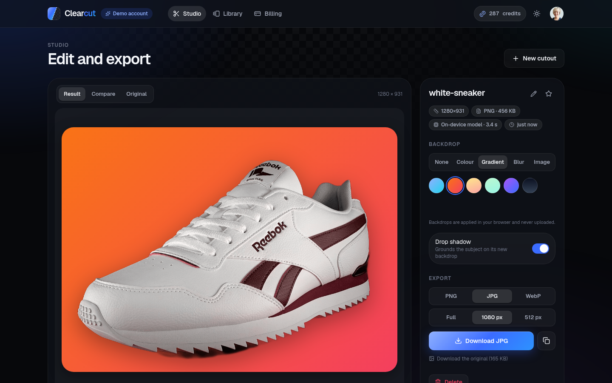
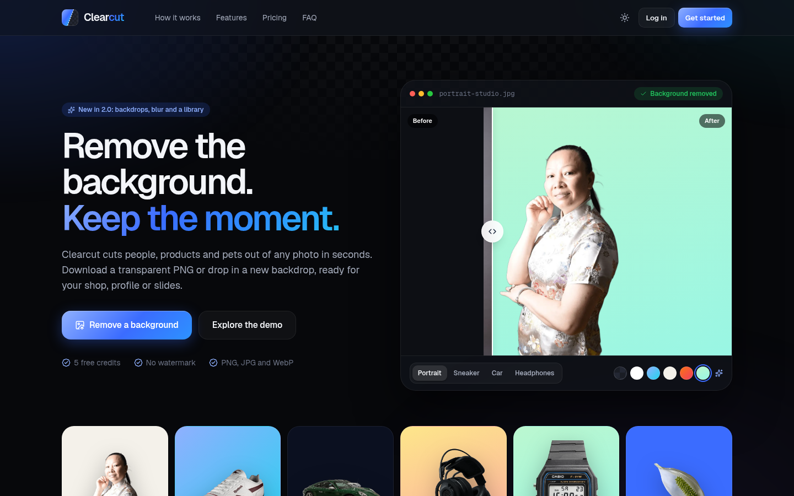
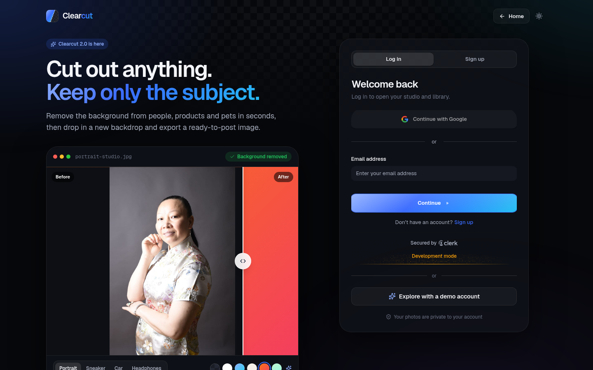
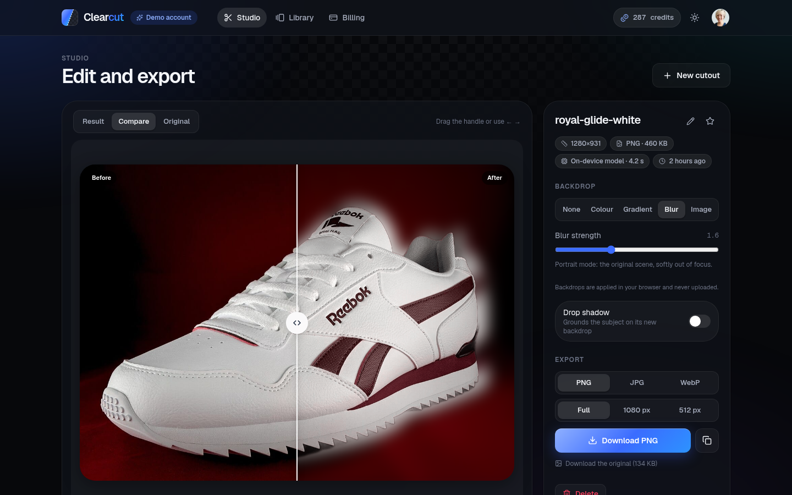
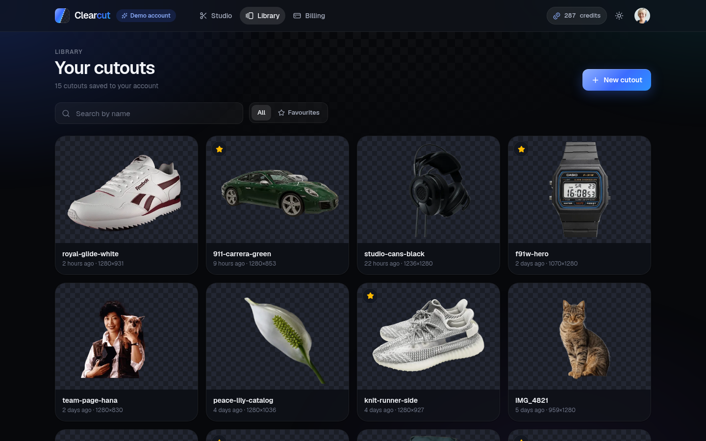
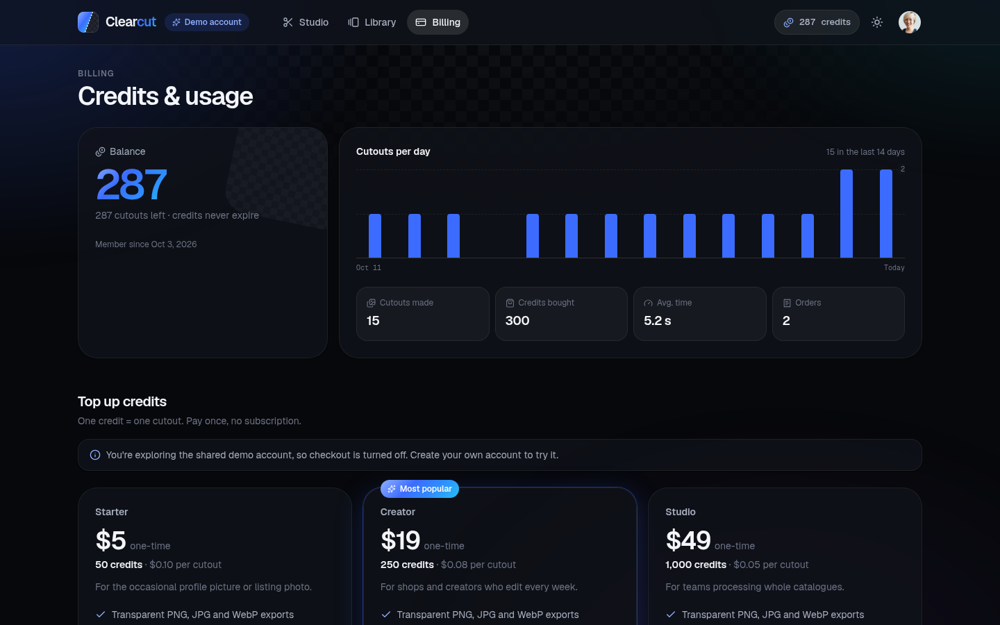
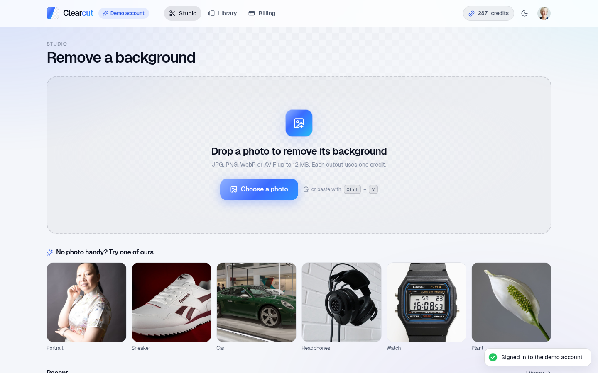
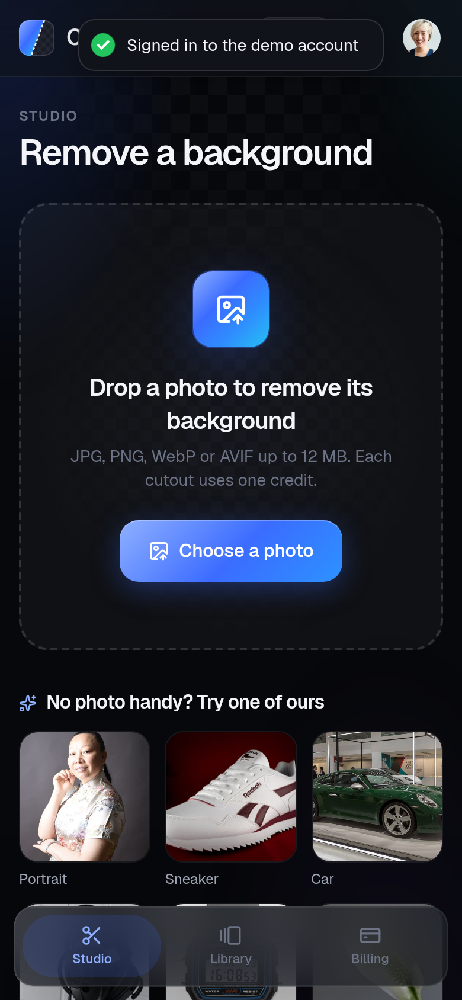
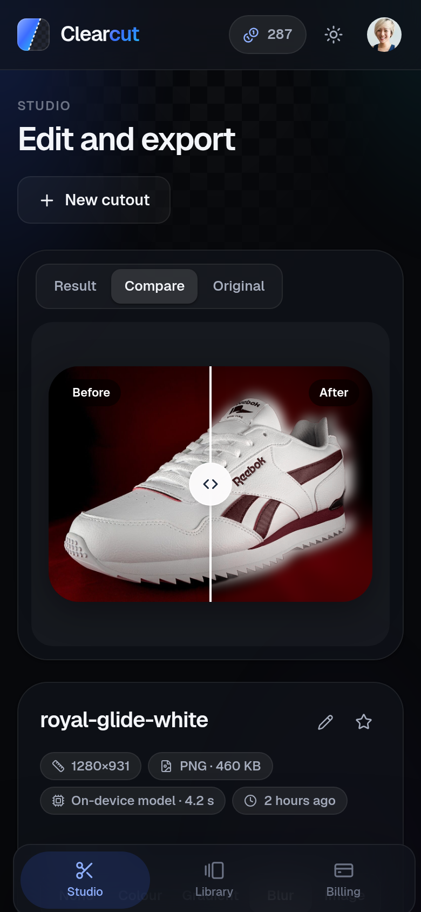
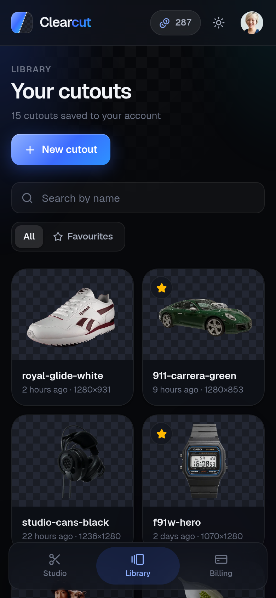

<div align="center">

# Clearcut

**Remove the background from any photo in seconds, then give it a new one.**

Upload or paste a photo, get a clean cutout, drop in a colour, gradient, blurred original or your own image, and export a ready-to-post PNG, JPG or WebP. Every cutout is saved to your library.



</div>

## What's new in 2.0

Clearcut started as a course project ("bg.removal"): one upload button, a spinner, one download link, and an API that paid ClipDrop for every image. 2.0 is a rebuild:

| Area | 1.0 | 2.0 |
|---|---|---|
| Engine | ClipDrop only (paid after the trial) | **Free on-device model by default** (IMG.LY, no key), or ClipDrop / remove.bg with one setting |
| Editing | Download the PNG | Compare slider, backdrops (colour, gradient, blurred original, your photo), drop shadow, PNG/JPG/WebP export at 3 sizes, copy to clipboard |
| History | Nothing was kept | A **library** of every cutout: search, favourites, rename, re-download |
| Design | Course template | 2026 design system: dark and light themes, glass panels, Geist, checkerboard motif, mobile tab bar |
| Security | JWT decoded without verification; Stripe credits added from a URL flag | Clerk-verified sessions, payments verified with Stripe / Razorpay, atomic credits, signed file URLs, **31 automated security checks** |
| Database | MongoDB | **Postgres on Neon** with a migrate script, foreign keys and check constraints |
| Data | Empty | `npm run seed`: demo account with a 15-image library, purchases and three more customers |

## Features

- **Studio**: drag and drop, file picker or paste (Ctrl/Cmd+V); real upload progress, then the cutout in a few seconds
- **Editor**: Result / Compare / Original views, a before/after slider (mouse, touch or arrow keys), backdrops, drop shadow
- **Export**: PNG or WebP with transparency, JPG on a backdrop; full size, 1080 px or 512 px; rendered in the browser so backdrops never leave your device
- **Library**: thumbnails on a transparency checkerboard, search, favourites, paging, download and delete
- **Credits**: 5 free credits for new accounts, one credit per cutout, refunded automatically if processing fails
- **Billing**: credit packs through Stripe Checkout and/or Razorpay (UPI, cards, netbanking), purchase history and a 14-day usage chart
- **Auth**: Clerk email/password and Google, plus "Explore with a demo account"
- **Polish**: skeletons, empty states, toasts, keyboard focus styles, `prefers-reduced-motion`, 390 px phones to wide desktops

## Screenshots

| | |
|---|---|
|  |  |
| Landing page with a live, interactive preview | Sign in with a live studio preview |
|  |  |
| Editor: blurred-original backdrop and export | Library of every cutout |
|  |  |
| Credits, usage and packs | Light theme |

<p align="center">
  
  
  
</p>

## Tech stack

| Part | Tech |
|---|---|
| Client | React 19, Vite 8, React Router 7, Tailwind CSS 4, lucide-react, react-hot-toast |
| Auth | Clerk (`@clerk/react` in the browser, `@clerk/express` on the API) |
| API | Node.js, Express 5, multer, sharp |
| Database | Postgres on [Neon](https://neon.tech) (`pg`), schema in `server/db/schema.sql` |
| Background removal | [`@imgly/background-removal-node`](https://github.com/imgly/background-removal-js) (default), ClipDrop or remove.bg APIs |
| Payments | Stripe Checkout and Razorpay Orders over their REST APIs |
| Fonts | Geist and Geist Mono (self-hosted via Fontsource) |

## Project structure

```
clearcut/
├── client/                    # React app (Vite)
│   ├── public/samples/        # Sample photos + cutouts for the landing page
│   └── src/
│       ├── pages/             # Landing, Auth, Studio, Library, Billing, NotFound
│       ├── components/
│       │   ├── ui/            # Logo, Avatar, Modal, EmptyState, CompareSlider, ThemeToggle, Loader
│       │   ├── studio/        # Dropzone, ProcessingView, Editor, BackdropPicker
│       │   ├── library/       # ImageCard
│       │   ├── billing/       # PlanCard, UsageChart
│       │   └── marketing/     # StudioPreview
│       ├── lib/               # theme, compose (canvas export), backgrounds, format, razorpay
│       ├── context/ hooks/    # account (credits, stats), theme
│       └── index.css          # design tokens and primitives
└── server/                    # Express API
    ├── lib/                   # providers (engines + queue), images (sharp, signed URLs), plans, payments, users
    ├── controllers/ routes/   # images, files, me, billing, demo, Clerk webhook
    ├── db/schema.sql          # tables, foreign keys, checks (npm run migrate)
    ├── middleware/            # Clerk auth, upload limits
    └── scripts/               # migrate.mjs, seed.mjs, security-test.mjs, samples/
```

## Getting started

### Prerequisites

- Node.js 20.9+
- A free [Neon](https://neon.tech) Postgres database (or any local Postgres)
- A free [Clerk](https://dashboard.clerk.com) application with Email (password on) and Google sign-in

### 1. Clone and install

```bash
git clone https://github.com/Yusuf-Hussain25/clearcut.git
cd clearcut
npm install          # root tools (concurrently)
npm run install:all  # server + client
```

The server's `.npmrc` skips onnxruntime's 400 MB CUDA download; the model runs on the CPU.

### 2. Configure

```bash
cp server/.env.example server/.env
cp client/.env.example client/.env
```

| File | Key | Where to find it |
|---|---|---|
| `server/.env` | `DATABASE_URL` | Neon → your project → **Connect** → copy the connection string |
| `server/.env` | `CLERK_PUBLISHABLE_KEY`, `CLERK_SECRET_KEY` | Clerk → **Configure → API keys** |
| `server/.env` | `ORIGINS` | Browser origins allowed to call the API (default `http://localhost:5173`) |
| `server/.env` | `DEMO_EMAIL`, `DEMO_PASSWORD`, `SEED_PASSWORD` | Your choice; used by `npm run seed` |
| `server/.env` | `STRIPE_SECRET_KEY`, `RAZORPAY_KEY_ID`, `RAZORPAY_KEY_SECRET` | Optional, see [Configurable providers](#configurable-providers) |
| `client/.env` | `VITE_CLERK_PUBLISHABLE_KEY` | Same publishable key |
| `client/.env` | `VITE_API_URL` | `http://localhost:4000` |
| `client/.env` | `VITE_DEMO_EMAIL` | Optional. Shows "Explore with a demo account" |

`.env` files are git-ignored. Only `VITE_` values reach the browser; Clerk's secret key and payment secrets stay on the server. If a required key is missing, the API prints which one and the client shows a setup screen instead of a blank page.

### 3. Create the tables and run

```bash
npm run migrate  # creates users, images and transactions (safe to re-run)
npm run dev    # API on :4000, client on :5173
npm run seed   # in a second terminal: demo account and data (API must be running)
```

Open http://localhost:5173 and click **Explore with a demo account**, or sign up (you get 5 free credits).

## Security

`npm run test:security` (with the API running) creates two throwaway Clerk users and checks 31 rules against the real API, then deletes them:

- requests without a session or with a forged token are rejected
- users can't read, rename, delete or list each other's images
- file links are signed per image and file kind and expire; tampered, swapped or expired links are refused
- uploads that aren't images are rejected and the credit is refunded
- three parallel uploads with one credit: exactly one succeeds and the balance never goes below zero
- unknown plans and providers are refused; forged Razorpay signatures, other users' orders and unknown Stripe sessions add no credits
- unsigned Clerk webhooks are refused

How it's enforced:

- Every API route verifies the Clerk session (`clerkMiddleware` + `getAuth`); the 1.0 API only decoded the token
- Images are always queried by `owner`; files are served through HMAC-signed URLs that expire
- A credit is reserved with one `UPDATE … WHERE credits > 0` before processing (and a `CHECK (credits >= 0)` in the schema), and refunded if anything fails
- Prices live on the server. Stripe purchases are confirmed by fetching the Checkout session from Stripe, Razorpay ones by their HMAC signature, and a purchase is fulfilled by a single statement that flips `pending → paid` and adds the credits, so it can't be credited twice
- The shared demo account can't buy credits or delete its sample images, and visitors' own uploads to it are removed after 24 hours

## Configurable providers

| Setting | Options |
|---|---|
| `BG_PROVIDER` | `local` (default): IMG.LY's open-source model runs inside the API. Free, no key, no rate limits, about 2 to 6 seconds per photo on a CPU. `clipdrop`: ClipDrop API (`CLIPDROP_API_KEY`), best on hair and fur. `removebg`: remove.bg API (`REMOVE_BG_API_KEY`, 50 free previews a month) |
| `LOCAL_MODEL` | `medium` (default) or `small` (faster, less memory) |
| `STRIPE_SECRET_KEY` | Empty: no card button. Set (test mode is fine): Stripe Checkout, verified on the server. Test card `4242 4242 4242 4242` |
| `RAZORPAY_KEY_ID` + `RAZORPAY_KEY_SECRET` | Empty: no Razorpay button. Set: UPI, cards, netbanking and wallets through Razorpay Checkout. Use `CURRENCY=INR` for most Razorpay accounts |
| `CURRENCY` | `USD` (default) or `INR`; prices for both are in `server/lib/plans.js` |
| `FREE_CREDITS`, `MAX_UPLOAD_MB`, `MAX_IMAGE_SIDE` | Starting credits (5), upload limit (12 MB), longest side kept (2048 px) |
| `CLERK_WEBHOOK_SIGNING_SECRET` | Optional. Keeps names and photos in sync and deletes data for deleted accounts. Accounts are created on first request either way |

With neither payment provider configured, the packs are still shown and the page explains that checkout isn't set up.

## Demo data

```bash
npm run seed                          # demo account + 3 more customers
npm run seed -- --with you@email.com  # also add 5 sample cutouts to your own account
```

The seeder creates Clerk accounts on `@clearcut-demo.dev` with randomuser.me photos, and uploads 15 sample photos (cars, watches, sneakers, headphones, portraits, products) through the real API with real sessions, so every image goes through the same auth, validation, engine and credit checks as the app. It then spreads them over two weeks, adds six favourites and two credit-pack purchases, and settles the balance. It's safe to re-run: accounts are matched by email and images by name.

| Account | Password |
|---|---|
| `DEMO_EMAIL` (Sam Rivera) | `DEMO_PASSWORD`, or the one-click demo button |
| `priya.nair@`, `daniel.okafor@`, `lena.fischer@clearcut-demo.dev` | `SEED_PASSWORD` |

## Deployment

**Client on Vercel**

1. Import the repo in Vercel, set **Root Directory** to `client`.
2. Add `VITE_CLERK_PUBLISHABLE_KEY`, `VITE_API_URL` (your API URL) and optionally `VITE_DEMO_EMAIL`.
3. Deploy. `client/vercel.json` rewrites every path to `index.html` for client-side routing.

**API on Render** (or any Node host with ~1 GB RAM)

The local model needs more disk and memory than a serverless function allows, so run the API as a web service:

1. Render → **New → Web Service** → this repo, **Root Directory** `server`, build `npm install`, start `npm start`.
2. Add the `server/.env` values, with `DATABASE_URL` from Neon and `ORIGINS` / `APP_URL` set to your Vercel URL.
3. On a small instance use `LOCAL_MODEL=small`, or set `BG_PROVIDER=clipdrop` / `removebg` to use an API instead (then any host works, Vercel included).

Finally, add the production domain in Clerk (**Configure → Domains**), run `npm run migrate` once against the Neon database, and seed it through the production API (`API_URL=https://… npm run seed --prefix server`).

## Credits

- Sample photos: [Wikimedia Commons](https://commons.wikimedia.org) contributors under CC0 / CC BY / CC BY-SA, listed with authors and licences in [`server/scripts/samples/CREDITS.md`](server/scripts/samples/CREDITS.md). The landing page uses six of them; their cutouts were made by Clearcut
- Profile photos for seeded accounts: [randomuser.me](https://randomuser.me)
- Background removal model: [IMG.LY background-removal-js](https://github.com/imgly/background-removal-js) (AGPL-3.0)

## Author

**Yusuf Hussain** · https://github.com/Yusuf-Hussain25
